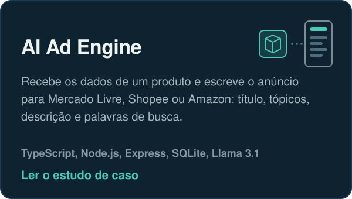
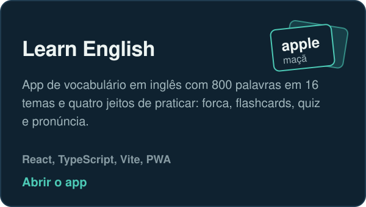
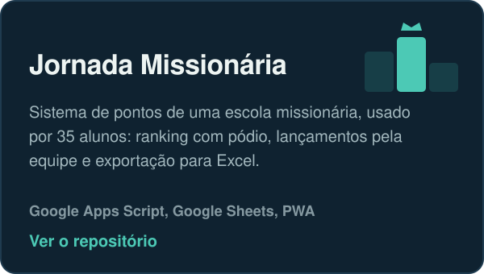
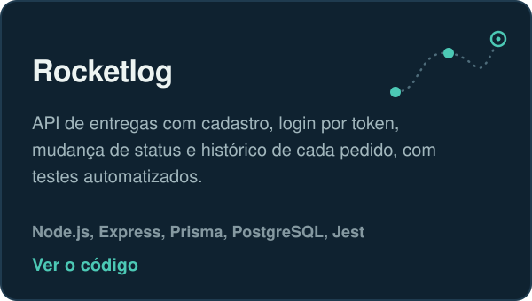
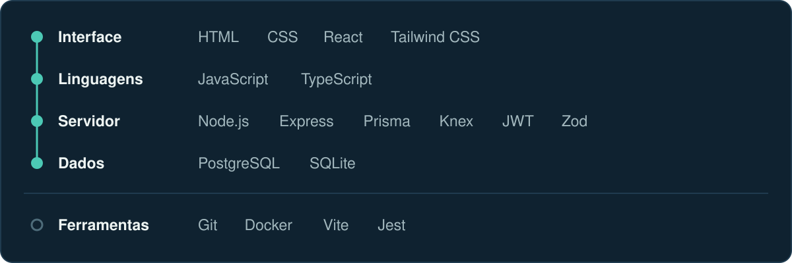

 

Crio aplicações web completas, da interface ao servidor. Hoje trabalho com TypeScript, React e Node.js e estou terminando Análise e Desenvolvimento de Sistemas (conclusão em dezembro de 2026).

Procuro minha primeira vaga como desenvolvedor júnior. Meu [portfólio](https://juanpablolpf.github.io/Meu-Portfolio/) tem os projetos em detalhe e o currículo.

### Projetos

 

 

Outras APIs que construí estudando back-end: [refund_api](https://github.com/juanpablolpf/refund_api) (reembolsos com upload de comprovante), [api-restaurant](https://github.com/juanpablolpf/api-restaurant) (pedidos e mesas com Knex) e [auth](https://github.com/juanpablolpf/auth) (autenticação com JWT).

### Tecnologias

### Contato

- Portfólio: [juanpablolpf.github.io/Meu-Portfolio](https://juanpablolpf.github.io/Meu-Portfolio/)
- LinkedIn: [Juan Pablo Lopes de Proença Filho](https://www.linkedin.com/in/juan-pablo-lopes-de-proen%C3%A7a-filho-b3a3002a7/)
- E-mail: [juanproencaf@gmail.com](mailto:juanproencaf@gmail.com)

<b>In English</b>

 

I'm a junior fullstack developer from Fortaleza, Brazil. I build complete web applications, from the interface to the server, mostly with TypeScript, React and Node.js. I'm finishing a degree in Systems Analysis and Development (December 2026) and I'm looking for my first junior role.

- **AI Ad Engine**: turns product data into ready-to-post listings for Mercado Livre, Shopee and Amazon. [Case study](https://juanpablolpf.github.io/Meu-Portfolio/projetos/ads-engine.html?lang=en)
- **Learn English**: vocabulary app with 800 words in 16 themes and four practice modes. [Open the app](https://juanpablolpf.github.io/LearnEnglish/)
- **Jornada Missionária**: points and ranking system used by 35 students at a missionary school.
- **Rocketlog**: delivery API with token login, status updates, history and automated tests.

Portfolio in English: [juanpablolpf.github.io/Meu-Portfolio/?lang=en](https://juanpablolpf.github.io/Meu-Portfolio/?lang=en)

